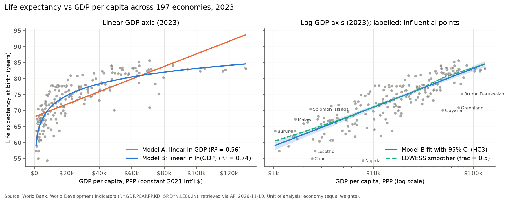
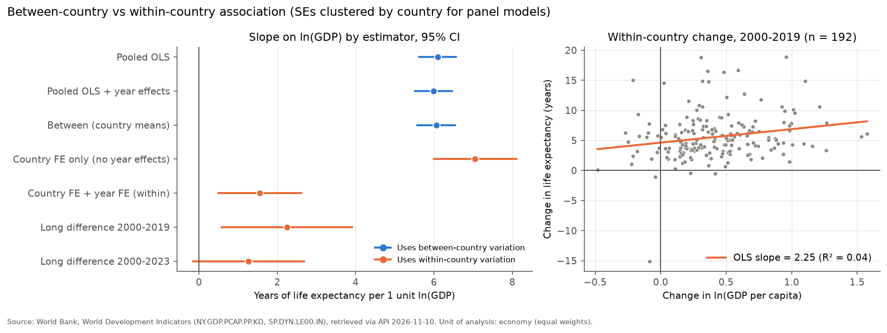

# Economic Development & Life Expectancy: A Cross-Country Statistical Analysis Using World Bank Data

A reproducible statistical study of the relationship between GDP per capita (PPP) and life expectancy at birth across 199 economies, 2000–2024. It uses official World Bank data retrieved through the World Bank API.

> **Scope.** This is an observational, ecological (country-level) analysis. It describes **associations** and makes **no causal claims**. Every economy is weighted equally, so the results describe the typical *country*, not the typical *person*. All numbers refer to the **WDI release of 2026-10-08**. Some of them change with other data releases (see [Data-version sensitivity](#data-version-sensitivity)).

**Author:** Seyhan Anıl Kaya · Department of Statistics, Fırat University

## Research problem

How is a country's level of economic output per person related to the life expectancy of its population?

1. How does life expectancy change as income rises?
2. Is the relationship linear, or does it show diminishing marginal gains?
3. How do Pearson and Spearman correlations differ?
4. How stable are the results over time?
5. Do outliers or influential countries change the conclusions?
6. Does the cross-country pattern match the pattern of change *within* countries over time?

## Data

| Indicator | Code | Unit | Licence |
|---|---|---|---|
| GDP per capita, PPP (constant 2021 international $) | [`NY.GDP.PCAP.PP.KD`](https://data.worldbank.org/indicator/NY.GDP.PCAP.PP.KD) | constant 2021 int'l $ | CC BY-4.0 |
| Life expectancy at birth, total (years) | [`SP.DYN.LE00.IN`](https://data.worldbank.org/indicator/SP.DYN.LE00.IN) | years | CC BY-4.0 |

* Source: World Bank, *World Development Indicators*, through the [v2 API](https://datahelpdesk.worldbank.org/knowledgebase/articles/889392).
* Retrieved **2026-11-10 13:46:55 UTC**. WDI release `lastupdated` = **2026-10-08**.
* Window: **2000–2024**. GDP data run to 2025 but life expectancy only to 2024.
* 217 economies after excluding 79 aggregates. **199 economies and 4,916 economy-years** have both indicators.
* 509 of the 5,425 economy-years (217 × 25; 9.4%) lack GDP data. 450 of these belong to the 18 economies with no GDP value at all, among them Cuba, Venezuela, Yemen, North Korea, South Sudan and Eritrea. Life expectancy has no missing values. Nothing was imputed.
* "Economies" include 14 non-sovereign territories (e.g. Hong Kong, Puerto Rico, Greenland). Excluding them barely changes any result.
* Raw API responses are kept unmodified in `data/raw/`, with a manifest of SHA-256 checksums. See [`reports/data_quality_report.md`](reports/data_quality_report.md) and [`data/data_dictionary.md`](data/data_dictionary.md).

## Methods (summary)

* Descriptive statistics, Pearson and Spearman correlations with Fisher-z 95% CIs.
* OLS on the 2023 cross-section (n = 197), with all models on the same sample: **Model A** LE ~ GDP, **Model B** LE ~ ln(GDP), and a quadratic-in-log check. HC3 robust standard errors.
* Diagnostics: RESET, Breusch–Pagan (Koenker), White, Jarque–Bera, Shapiro–Wilk, leverage, Cook's distance, DFBETAS. Refits without influential points, and a Huber robust regression.
* Over time: a separate cross-section for each year 2000–2024, on all economies and on a constant set of 189 economies. A slope-trend test with country-clustered SEs. Pooled, between, country-FE and **two-way FE** panel models with **country-clustered SEs**. Long differences 2000→2019 and 2000→2023.
* An independent audit ([`audit/run_audit.py`](audit/run_audit.py)) re-computes every key number by a second method, compares data releases and runs the sensitivity analyses.

Full details: [`reports/methodology.md`](reports/methodology.md).

## Main findings

Values for the 2023 cross-section unless stated otherwise. Brackets are 95% CIs.

| Result | Estimate |
|---|---|
| Spearman ρ (GDP, LE) | 0.872 [0.827, 0.907] |
| Pearson r: GDP level / ln GDP | 0.749 [0.680, 0.804] / 0.861 [0.820, 0.894] |
| Model A (linear): slope per \$1,000, R², AIC | 0.197 [0.162, 0.232], 0.560, 1172.1 |
| **Model B (log): slope per ln unit, R², AIC** | **5.27 [4.85, 5.68], 0.742, 1067.2** |
| Model B: years per 10% / per doubling of GDP | 0.50 / 3.65 |
| Quadratic term in ln GDP | 0.17 [−0.18, 0.52], p = 0.34 (no extra curvature) |
| Model B slope across all sensitivity analyses | 5.25 – 5.42 |
| Change in the yearly slope, 2000–2024 | −0.041 per year [−0.064, −0.017], p < 0.001 (6.49 in 2000 → 5.27 in 2023) |
| Between-country slope (country means) | 6.06 [5.57, 6.54] |
| **Within-country slope (country + year FE)** | **1.55 [0.49, 2.61]** (range 1.33–1.84 across sensitivity analyses and data releases) |
| Long difference 2000→2019 / 2000→2023 | 2.25 [0.59, 3.91] / 1.27 [−0.15, 2.69] |

1. Life expectancy rises steeply with income among poor countries and flattens among rich ones. The relationship is **close to linear in log GDP**. The linear-in-levels model is clearly misspecified (RESET p < 10⁻¹⁷). The log model shows no remaining non-linearity (RESET p = 0.36).
2. Spearman's ρ is well above the Pearson r on GDP levels. The relationship is strongly **monotone but not linear**. After the log transform, the two coefficients almost coincide.
3. The **strength** of the association is stable over 25 years (ρ ≈ 0.85–0.88). The **slope** has declined by about 19%: the cross-country curve flattened, so countries with the same log-income gap now differ less in life expectancy. Whether the curve also shifted upward at a given income level, as reported in the literature, was **not tested** here.
4. The cross-sectional results are **robust** to influential observations, robust regression, a constant country sample, excluding territories, excluding the richest economies, using 2024 instead of 2023, and the data release.
5. **The cross-country gradient does not describe within-country change.** Once common global trends are removed, within-country income growth is associated with only about one quarter of the cross-sectional slope. That estimate is less precise and more sensitive to data revisions. A model with country FE but **no** year effects gives a misleading 7.05, which shows how shared trends inflate associations.





Full report in Turkish: [`reports/research_report_tr.md`](reports/research_report_tr.md). Audit: [`reports/final_scientific_audit_tr.md`](reports/final_scientific_audit_tr.md).

## Data-version sensitivity

WDI is revised several times a year. The audit compared the current release with archived releases through the WDI Database Archives API (source 57):

* The **April 2025** release revised life expectancy for 196 of the 212 economies compared, by 0.60 years on average (2000–2022). It also introduced extreme values for the **Central African Republic**: 14.7 years in 2009, 31.5 in 2019 and 18.8 in 2022. Until March 2025 the published values were 48.6, 55.0 and 54.5. The April 2025 release note does not mention life expectancy, so the reason for the revision is **not documented**.
* **Cross-country results hardly change.** Model B slope for 2022: 5.53 with the current release, 5.52 with the March 2025 release.
* **Within-country results do change.** Two-way FE slope for 2000–2022: 1.84 with the current release, 1.55 with the March 2025 release. Without the Central African Republic, the 2000→2019 long difference falls from 2.25 to 1.83.

Re-running `python src/run_pipeline.py` without `--offline` downloads the *current* release. The results may then differ from those reported here.

### Archived releases stored in this repository

| File in `data/raw/archive/` | WDI release | Used for |
|---|---|---|
| `SP.DYN.LE00.IN_v202503.json.gz` | March 2025 (last release before the revision) | data-version sensitivity (1.55 vs 1.84), CAF history |
| `SP.DYN.LE00.IN_v202504.json.gz` | April 2025 (first release with the revision) | size of the revision (196/212 economies) |
| `ARCHIVE_MANIFEST.json` | – | SHA-256 and size of each **original** download and of each `.gz` file |

* The files are **lossless, deterministic gzip** files (mtime = 0). Decompressed, they are byte-identical to the original API downloads of 2026-11-10.
* `audit/run_audit.py` reads them through `audit/archive_io.py`. That module checks the SHA-256 of the decompressed bytes against the manifest and stops if they differ. No manual decompression is needed.
* To check the files by hand: `python audit/archive_io.py verify`.
* The December 2024 release was also downloaded during the audit, but it is **not published**. Its values are identical to the March 2025 release for all economies, so no result depends on it. Its SHA-256 is recorded under `not_published` in the manifest. Like the July 2024 release, it can be queried again from the World Bank API.
* `python audit/run_audit.py --refetch` re-downloads releases 202503 and 202504 and reports whether they are still identical to the stored originals. It never overwrites them.

## What could not be verified about the 2024 data

* **Estimates or projections?** The WDI April 2026 release note says demographic indicators were "updated with 2024 data". It does not say whether the 2024 life-expectancy values are estimates or projections, nor which UN *World Population Prospects* edition they come from. API footnotes and `obs_status` are empty. The UN data-portal API could not be queried (it requires an access token).
* **Indirect evidence only.** For 165 economies the 2024 value has the 3-decimal format typical of UN WPP data. For 52 it appears to be derived from male and female values from national offices or Eurostat; this inference comes from the numeric pattern only. Changes from 2023 to 2024 are unusually smooth (SD 0.35 years, against 2.82 for 2022→2023). This suggests that most 2024 values are model-based, but it is **not proof**.
* **Consequence.** The primary analysis therefore uses **2023**. The 2024 cross-section gives the same result (slope 5.26 vs 5.27). Whether the 2023 values are estimates was not verified either.

## Limitations

* Correlation is not causation. Confounding (education, institutions, health systems, inequality, disease burden, conflict) and reverse causality (health → productivity) are not addressed.
* The **ecological fallacy**: country-level associations do not carry over to individuals.
* GDP per capita is average output. It is not household income and says nothing about its distribution. PPPs are ICP benchmarks only for 2011–2021; other years are extrapolated, and PPPs for non-participating countries are imputed by regression (WDI metadata).
* Missing data are **not random**. Economies in conflict, under sanctions or closed, and many small territories, are excluded.
* Results weight countries equally. No population-weighted analysis was run.
* WDI metadata states that annual UN WPP life-expectancy series are interpolated and "may not reflect real events as much as observed data". This matters most for the within-country analysis.
* The results refer to one data release. See [Data-version sensitivity](#data-version-sensitivity).

## Project structure

```
├── LICENSE                  MIT licence (code only)
├── LICENSE-DOCS.md          CC BY 4.0 for the project's original written content
├── DATA_LICENSE.md          World Bank CC BY 4.0 attribution for data and derived files
├── data/
│   ├── raw/                 unmodified API responses + manifest (UTC time, SHA-256)
│   │   └── archive/         2 archived WDI releases (.json.gz) + ARCHIVE_MANIFEST.json
│   ├── processed/           panel, analysis sample, coverage tables, cleaning log
│   └── data_dictionary.md
├── notebooks/01_analysis.ipynb   step-by-step analysis (executed)
├── src/
│   ├── download_data.py     API client: pagination, retries, validation
│   ├── clean_data.py        aggregate removal, merge, flags, exclusion reasons
│   ├── statistical_analysis.py   correlations, regressions, diagnostics, panel models
│   ├── make_figures.py      all figures
│   └── run_pipeline.py      runs everything in order
├── audit/
│   ├── run_audit.py         independent re-computation, data-release comparison, sensitivity
│   └── archive_io.py        integrity-checked reading/writing of the gzip archive files
├── figures/                 7 figures (PNG)
├── reports/
│   ├── research_report_tr.md          full academic report (Turkish)
│   ├── final_scientific_audit_tr.md   pre-publication audit (Turkish)
│   ├── student_learning_guide_tr.md   learning guide + exercises (Turkish)
│   ├── methodology.md · data_quality_report.md · technical_report.md
│   ├── release_readiness_report_tr.md pre-publication checklist and log (Turkish)
│   ├── tables/              every computed table (CSV) + results.json
│   └── audit/               audit outputs, economy lists
└── tests/                   pytest: cleaning, statistics, archive integrity, mocked API, 1 live API test
```

## Installation and reproduction

Tested with Python 3.14.4 on Windows 11, using the exact versions in `requirements.txt`, in a fresh virtual environment. Other versions are untested.

```bash
git clone https://github.com/seyhanil1/economic-development-life-expectancy.git
cd economic-development-life-expectancy
python -m venv .venv && source .venv/bin/activate   # Windows: .venv\Scripts\activate
pip install -r requirements.txt
```

The commands below are run from the project root.

```bash
# Reproduce the published results exactly from the saved raw data
python src/run_pipeline.py --offline

# Or download the current WDI release first (numbers may differ, see above)
python src/run_pipeline.py

# Re-run the audit (reads data/raw/archive/*.json.gz, SHA-256 checked)
python audit/run_audit.py

# Verify the archive files against their recorded SHA-256
python audit/archive_io.py verify

# Tests (offline); add --run-network for the live API test
pytest
pytest --run-network

# Execute the notebook
jupyter nbconvert --to notebook --execute --inplace notebooks/01_analysis.ipynb
```

## References

* Acemoglu, D., & Johnson, S. (2007). Disease and development: The effect of life expectancy on economic growth. *Journal of Political Economy*, 115(6), 925–985.
* Bloom, D. E., & Canning, D. (2007). Commentary: The Preston Curve 30 years on: still sparking fires. *International Journal of Epidemiology*, 36(3), 498–499.
* Cameron, A. C., & Miller, D. L. (2015). A practitioner's guide to cluster-robust inference. *Journal of Human Resources*, 50(2), 317–372.
* Deaton, A. (2003). Health, inequality, and economic development. *Journal of Economic Literature*, 41(1), 113–158.
* MacKinnon, J. G., & White, H. (1985). Some heteroskedasticity-consistent covariance matrix estimators with improved finite sample properties. *Journal of Econometrics*, 29(3), 305–325.
* Preston, S. H. (1975). The changing relation between mortality and level of economic development. *Population Studies*, 29(2), 231–248.
* Pritchett, L., & Summers, L. H. (1996). Wealthier is healthier. *Journal of Human Resources*, 31(4), 841–868.
* Robinson, W. S. (1950). Ecological correlations and the behavior of individuals. *American Sociological Review*, 15(3), 351–357.
* World Bank (2026). *World Development Indicators*. https://data.worldbank.org/ (CC BY 4.0).

## Licence

This repository uses three licence scopes, which do not overlap:

| Scope | Files | Licence | Licence file |
|---|---|---|---|
| **Code** | `src/`, `audit/`, `tests/`, notebook code cells, `requirements.txt`, `pytest.ini`, `.gitignore`, `.gitattributes` | MIT | [`LICENSE`](LICENSE) |
| **Original written content** | `README.md`, `reports/*.md`, `data/data_dictionary.md`, notebook Markdown cells | CC BY 4.0 (author) | [`LICENSE-DOCS.md`](LICENSE-DOCS.md) |
| **World Bank data and derivatives** | `data/raw/`, `data/processed/`, `reports/tables/`, `reports/audit/`, `figures/`, notebook outputs, and the data values quoted in the texts | CC BY 4.0 (World Bank) | [`DATA_LICENSE.md`](DATA_LICENSE.md) |

Reusing figures, tables or numbers requires the World Bank attribution given in `DATA_LICENSE.md`. This applies even when they are quoted inside the CC BY 4.0 texts.

## Purpose

This project was carried out by a second-year statistics student for **education and portfolio purposes**. It aims to show a careful, transparent and reproducible workflow: official data, documented cleaning, appropriate methods, diagnostics, an independent audit and honest reporting of uncertainty. It is not peer-reviewed research.

## AI assistance

This project was developed with the help of **Claude (Anthropic)**, an AI model. For that reason Claude appears as a co-author in the commit history.

* **Claude's role:** wrote most of the code and drafted the reports, under the author's direction.
* **The author's role:** defined the research questions and scope, made the methodological and publication decisions, requested the independent audit and its corrections, and reviewed and approved every change.
* **How the results were checked:** every number in the reports is produced by the code in this repository, from the archived official data. Each number is checked by automated tests (`pytest`) and by an independent re-computation (`audit/run_audit.py`). Statements that could not be verified are marked as such.
