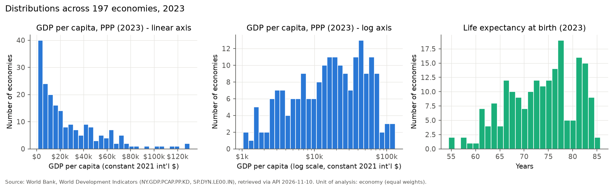
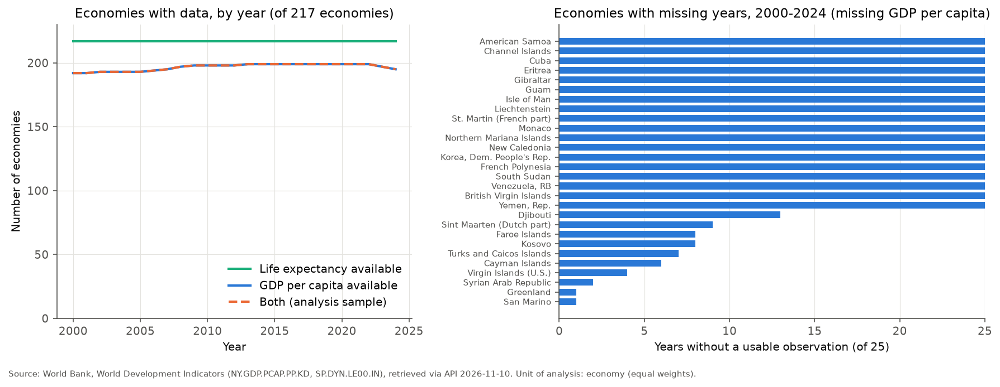
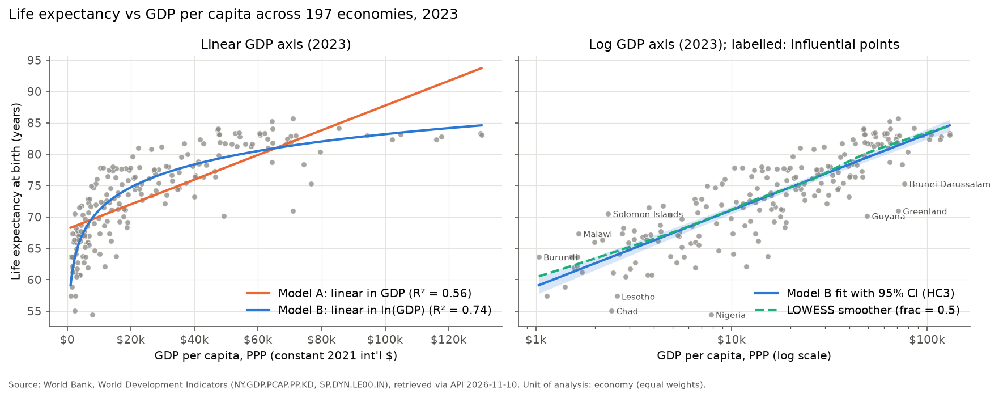
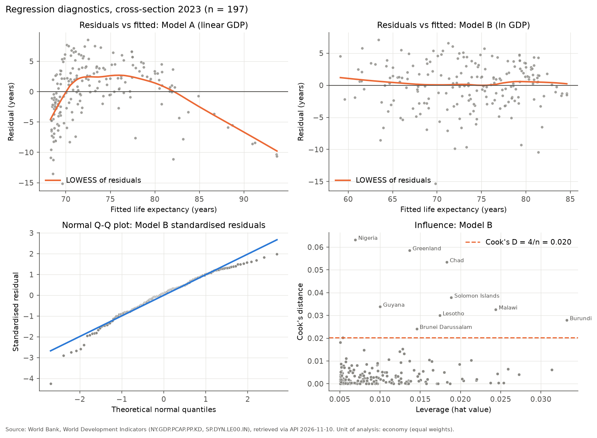
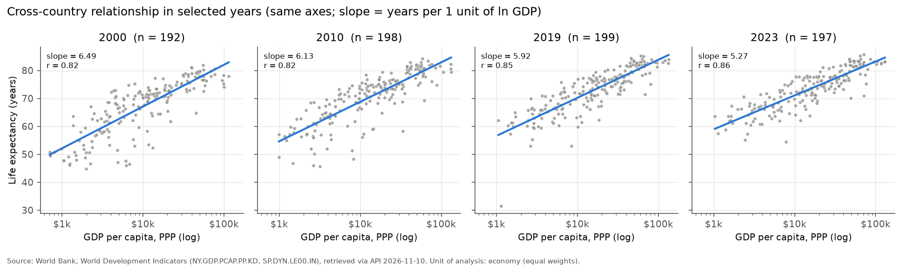
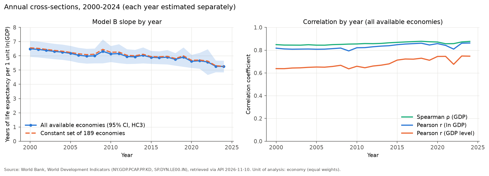
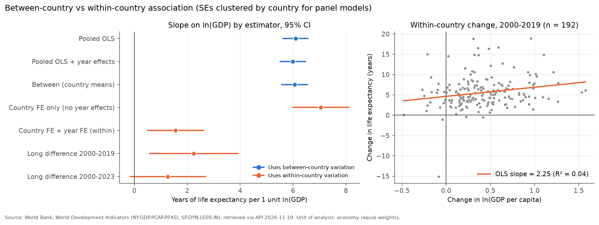

# Ekonomik Gelişmişlik ve Yaşam Beklentisi: Dünya Bankası Verileriyle Ülkeler Arası İstatistiksel Bir Analiz

*Economic Development & Life Expectancy: A Cross-Country Statistical Analysis Using World Bank Data*

**Yazar:** Seyhan Anıl Kaya · İstatistik Bölümü, Fırat Üniversitesi (Department of Statistics, Fırat University)

Veri çekme tarihi: 10 Kasım 2026, 13:46:55 UTC · WDI veritabanı sürümü (`lastupdated`): 8 Ekim 2026 · Analiz dönemi: 2000–2024

---

## 1. Özet

Bu çalışma, kişi başına GSYH (satın alma gücü paritesine göre, sabit 2021 uluslararası doları) ile doğuşta beklenen yaşam süresi arasındaki ilişkiyi Dünya Bankası World Development Indicators verileriyle inceler. Veriler resmî API'den çekildi. Toplulaştırılmış 79 bölge ve grup ayıklandıktan sonra 199 ekonomiye ait 4.916 ülke-yıl gözlemi analize girdi. Temel kesit yılı olan 2023'te (n = 197) gelir ile yaşam beklentisi arasında güçlü ve pozitif bir ilişki var. Spearman ρ = 0,872 [%95 GA: 0,827–0,907]. Pearson r, gelir düzeyiyle 0,749, gelirin logaritmasıyla 0,861'dir. Log-doğrusal model (R² = 0,742), doğrusal modelden (R² = 0,560) belirgin biçimde daha iyi uyum gösterir (AIC 1067 vs 1172). Doğrusal modelin artıkları açık bir eğrisellik taşır (RESET p < 10⁻¹⁷). Log-doğrusal modelde ise RESET testi ek bir eğrisellik bulmaz (p = 0,36). Bu modele göre ülkeler arasında %10 daha yüksek gelir yaklaşık 0,50 yıl, iki kat gelir ise yaklaşık 3,65 yıl daha yüksek yaşam beklentisiyle ilişkilidir. Dolayısıyla gelir düzeyi arttıkça ek gelirle ilişkili yaşam süresi kazancı azalır. Etkili gözlemler çıkarıldığında ve dayanıklı regresyon kullanıldığında eğim 5,26–5,42 aralığında kalır. Kesitsel eğim 2000'den 2024'e anlamlı biçimde azalmıştır: yılda −0,041 [−0,064; −0,017]. Ülkelerin kendi içindeki zaman değişimlerine bakıldığında tablo çok farklıdır. Ülke ve yıl sabit etkili modelde eğim 1,55 [0,49; 2,61], 2000–2019 uzun fark modelinde 2,25 [0,59; 3,91] bulunmuştur. Bu değerler kesitsel eğimin yaklaşık üçte biri ile dörtte biri arasındadır ve 2000–2023 uzun farkında istatistiksel olarak belirsizdir. Ülke içi tahmin veri sürümüne duyarlıdır. Mart 2025 WDI sürümüyle 2000–2022 eğimi 1,55, güncel sürümle 1,84 bulunur. Kesitsel tahmin ise iki sürümde de aynıdır. Sonuçlar gözlemsel ve ekolojiktir. Nedensellik iddiası taşımaz.

**Anahtar kelimeler:** Preston eğrisi, yaşam beklentisi, kişi başına GSYH, log-doğrusal regresyon, sabit etkiler, ekolojik çıkarım

## 2. Giriş ve araştırma motivasyonu

Ülkelerin ortalama gelir düzeyi ile ortalama yaşam süresi arasındaki ilişki, Preston (1975) tarafından tanımlandığından beri sağlık ekonomisi ve nüfus biliminin en çok incelenen ampirik örüntülerinden biridir. Bu örüntüye "Preston eğrisi" denir. Eğri yoksul ülkelerde dik, zengin ülkelerde yatıktır. Ayrıca zaman içinde yukarı kaydığı bilinmektedir: aynı gelir düzeyinde daha uzun yaşam (Preston, 1975; Bloom ve Canning, 2007). Bu ilişkinin ne ölçüde gelirin bir *sonucu* olduğu tartışmalıdır. Gelir beslenmeyi, sanitasyonu ve sağlık hizmetlerine erişimi iyileştirebilir (Pritchett ve Summers, 1996). Öte yandan tıbbi bilgi ve teknolojinin yayılması, kamu sağlığı politikaları ve kurumlar da gelirden bağımsız olarak yaşam süresini değiştirebilir (Deaton, 2003; Acemoglu ve Johnson, 2007).

Bu çalışmanın amacı nedensel bir soruyu yanıtlamak değildir. Amaç, güncel ve resmî verilerle ilişkinin **biçimini, gücünü, zaman içindeki kararlılığını ve ülkeler arası örüntünün ülke içi değişimlerle ne kadar örtüştüğünü** şeffaf ve tekrar üretilebilir biçimde betimlemektir.

## 3. Araştırma soruları

**Ana soru:** Ülkelerin kişi başına ekonomik üretim düzeyi ile doğuşta beklenen yaşam süresi arasında nasıl bir istatistiksel ilişki vardır?

1. Gelir düzeyi yükseldikçe yaşam beklentisi nasıl değişiyor?
2. İlişki doğrusal mı, yoksa azalan marjinal artışlar gösteren doğrusal olmayan bir yapıda mı?
3. Pearson ve Spearman korelasyonları arasında nasıl farklar var?
4. Sonuçlar farklı yıllarda ne kadar değişiyor?
5. Aykırı veya yüksek etkili gözlemler model sonuçlarını değiştiriyor mu?
6. Ülkeler arası örüntü, ülkelerin zaman içindeki değişimleriyle aynı örüntüyü mü gösteriyor?

Altı sorunun tamamı mevcut verilerle yanıtlanabildi. Kapsam daraltılmadı. 6. soru yalnızca *ilişkisel* düzeyde yanıtlanmıştır.

## 4. Veri kaynakları

| Gösterge | Kod | Birim | Kaynak | Lisans |
|---|---|---|---|---|
| Kişi başına GSYH, SGP (sabit 2021 uluslararası $) | `NY.GDP.PCAP.PP.KD` | sabit 2021 uluslararası $ | Dünya Bankası, Uluslararası Karşılaştırma Programı (ICP), ulusal hesaplar | CC BY-4.0 |
| Doğuşta beklenen yaşam süresi, toplam | `SP.DYN.LE00.IN` | yıl | BM Dünya Nüfus Beklentileri (WPP), ulusal istatistik kurumları, Eurostat | CC BY-4.0 |

* Veriler `https://api.worldbank.org/v2` adresinden sayfalandırmalı olarak çekildi. Her gösterge için API'nin bildirdiği 6.916 kaydın tamamı alındı ve sayı doğrulandı.
* Tanım, birim ve lisans bilgisi API'nin meta veri uç noktasından okundu (`data/raw/indicator_metadata.json`).
* Ham API yanıtları değiştirilmeden `data/raw/` klasöründe saklandı. SHA-256 özetleri `download_manifest.json` dosyasındadır.
* GSYH verisi 2025'e kadar, yaşam beklentisi verisi 2024'e kadar uzanıyor. Ortak dönem olan **2000–2024** analiz için kullanıldı.
* Ayrıntılar: `reports/data_quality_report.md`.

**Örneklem:** Dünya Bankası listesindeki 296 varlığın 79'u toplulaştırmadır (Dünya, OECD, AB, gelir grupları, bölgeler) ve dışlandı. Gelir grubu toplulaştırmalarının bir kısmının API'de ISO3 kodu boştu. Bu kayıtlar 2 harfli kimlikleri üzerinden eşleştirilerek dışlandı. Kalan 217 ekonomiden 199'u en az bir yılda her iki göstergeye sahiptir. 18 ekonominin hiçbir yılda GSYH verisi yoktur: Küba, Venezuela, Yemen, Kuzey Kore, Güney Sudan, Eritre ve 12 küçük ada veya bölge. Toplam 5.425 ülke-yılın 509'u (%9,4) GSYH eksikliği nedeniyle dışlandı. Yaşam beklentisinde eksik değer yoktur. Eksik değerler sıfırla doldurulmadı, tahminle de tamamlanmadı.

## 5. Değişken tanımları

* **Yaşam beklentisi (LE):** O yılın yaşa özgü ölüm hızları yaşam boyu sabit kalsaydı, yeni doğan bir bebeğin ortalama yaşayacağı yıl sayısı. Bir *dönem* ölçüsüdür. Kriz yıllarında (savaş, afet, salgın) keskin düşüşler gösterebilir.
* **Kişi başına GSYH (GDP):** Bir ülkede üretilen toplam katma değerin nüfusa bölünmüş hâli. Fiyat düzeyi farkları satın alma gücü paritesiyle, enflasyon ise sabit 2021 fiyatlarıyla arındırılmıştır. Bireysel gelir veya hane geliri **değildir**. Gelir dağılımı hakkında bilgi içermez.
* **ln(GDP):** GSYH'nin doğal logaritması. Yalnızca GDP > 0 için tanımlıdır. Veride sıfır veya negatif değer yoktur, ancak kod bu durumu ayrıca denetler.
* **İşaretli gözlemler:** Yaşam beklentisi 40 yılın altında olan ya da her iki komşu yıldan 5 yıldan fazla sapan değerler (ör. Orta Afrika Cumhuriyeti 2009: 14,7 yıl; Haiti 2010; Somali 2011). Bunlar güncel WDI sürümünde yayımlanan değerlerdir. Orta Afrika Cumhuriyeti'ndeki sert düşüşler Mart 2025 sürümüne kadar yoktu. Seri o tarihe kadar düzgündü (2019: 55,0; 2022: 54,5). Düşüşler Nisan 2025 revizyonuyla geldi (bkz. `final_scientific_audit_tr.md`). Bu değerler silinmedi, duyarlılık analizlerinde dışlandı.

## 6. Yöntem

Ayrıntılı gerekçeler `reports/methodology.md` dosyasındadır. Özetle:

1. **Betimsel istatistikler:** n, ortalama, medyan, standart sapma, çeyreklikler, en küçük ve en büyük değer, çarpıklık, basıklık.
2. **Korelasyon:** Pearson r ve Spearman ρ. Güven aralıkları Fisher z dönüşümüyle hesaplandı (Spearman için Bonett ve Wright, 2000).
3. **Regresyon (2023 kesiti, aynı 197 gözlem):** Model A: LE = β₀ + β₁·GDP. Model B: LE = β₀ + β₁·ln(GDP). Ek olarak eğrisellik kontrolü için Model C: ln(GDP)'nin ikinci dereceden terimi. Standart hatalar değişen varyansa dayanıklı **HC3** yöntemiyle hesaplandı (MacKinnon ve White, 1985). Klasik standart hatalar da karşılaştırma için raporlandı.
4. **Tanısal kontroller:** Artık–tahmin grafiği, RESET, Breusch–Pagan, White, Jarque–Bera, Shapiro–Wilk, kaldıraç, Cook uzaklığı, DFBETAS. Etkili gözlemler çıkarılarak ve Huber dayanıklı regresyonuyla yeniden kestirim yapıldı.
5. **Zamansal analiz:** (a) 2000–2024 arasında her yıl için ayrı kesit regresyonu. Bileşimin değişmesi sonucu etkilemesin diye 25 yılın tamamında gözlenen sabit 189 ülkeyle de tekrarlandı. Eğimin zamanla değişip değişmediği, ülke düzeyinde kümelenmiş standart hatalı tek bir etkileşim modeliyle test edildi. (b) Ülke içi değişim için havuzlanmış, ülke ortalamaları (between), ülke sabit etkili, ülke + yıl sabit etkili (iki yönlü FE) modeller ve 2000→2019 ile 2000→2023 uzun fark modelleri kestirildi. Aynı ülkenin tekrarlanan gözlemleri bağımsız olmadığı için panel modellerin tümünde standart hatalar **ülke düzeyinde kümelendi** (Cameron ve Miller, 2015).

**Ağırlıklandırma:** Tüm analizlerde her ülke eşit ağırlıktadır. Sonuçlar "tipik ülke" hakkındadır, "tipik insan" hakkında değildir. Nüfus ağırlıklı bir analiz Hindistan ve Çin'e çok daha fazla ağırlık verirdi ve farklı bir soruyu yanıtlardı.

## 7. Betimsel istatistikler

**Tablo 1.** Seçilmiş yıllarda betimsel istatistikler (kaynak: `reports/tables/descriptive_statistics.csv`)

| Yıl | Değişken | n | Ortalama | Medyan | SS | Q1 | Q3 | Min | Maks | Çarpıklık |
|---|---|---|---|---|---|---|---|---|---|---|
| 2000 | GSYH (\$) | 192 | 19.141 | 10.589 | 22.362 | 3.819 | 23.098 | 703 | 114.148 | 1,87 |
| 2000 | LE (yıl) | 192 | 67,02 | 70,06 | 9,65 | 61,17 | 73,94 | 44,83 | 81,86 | −0,66 |
| 2010 | GSYH (\$) | 198 | 23.634 | 14.101 | 25.414 | 4.890 | 33.945 | 988 | 132.502 | 1,87 |
| 2010 | LE (yıl) | 198 | 70,40 | 72,35 | 8,81 | 64,55 | 76,74 | 45,58 | 84,20 | −0,72 |
| 2019 | GSYH (\$) | 199 | 26.353 | 16.761 | 26.295 | 6.338 | 38.237 | 1.055 | 133.454 | 1,62 |
| 2019 | LE (yıl) | 199 | 72,72 | 73,76 | 7,99 | 66,87 | 78,41 | 31,53 | 85,26 | −0,95 |
| **2023** | **GSYH (\$)** | **197** | **27.405** | **17.686** | **26.991** | **6.521** | **41.320** | **1.033** | **130.297** | **1,50** |
| **2023** | **LE (yıl)** | **197** | **73,47** | **74,40** | **7,09** | **67,69** | **78,47** | **54,46** | **85,71** | **−0,36** |
| 2023 | ln(GSYH) | 197 | 9,67 | 9,78 | 1,16 | 8,78 | 10,63 | 6,94 | 11,78 | −0,33 |

**Yorum.** Kişi başına GSYH'nin dağılımı güçlü biçimde **sağa çarpıktır** (2023'te çarpıklık 1,50, ortalama medyandan yaklaşık 9.700 \$ yüksek). Az sayıda çok zengin ekonomi ortalamayı yukarı çeker: Singapur 130.297 \$, Lüksemburg 130.049 \$, İrlanda 117.660 \$. En düşük değerler Burundi (1.033 \$), Orta Afrika Cumhuriyeti (1.133 \$) ve Somali'dedir (1.402 \$). En yoksul ile en zengin arasında yaklaşık 126 kat fark vardır. Logaritmik dönüşüm bu çarpıklığı neredeyse ortadan kaldırır (çarpıklık −0,33). Yaşam beklentisi **sola çarpıktır**: ülkelerin çoğu 65–80 yıl arasında toplanırken düşük değerli bir kuyruk vardır. 2023'te en düşük değerler Nijerya (54,5), Çad (55,1) ve Lesotho'da (57,4), en yüksek değerler San Marino (85,7), Hong Kong (85,2) ve İsviçre'dedir (84,2). Ortalama yaşam beklentisi 2000'de 67,0 yıldan 2023'te 73,5 yıla yükselmiş, ülkeler arası standart sapma 9,65'ten 7,09'a düşmüştür. Yani ülkeler yaşam beklentisi açısından birbirine yakınlaşmıştır. 2019 için en küçük değer 31,5 yıldır (Orta Afrika Cumhuriyeti, işaretli kriz yılı değeri). Bu değer o yılın standart sapmasını ve çarpıklığını belirgin biçimde etkiler. (Şekil 1, Şekil 2)

*Şekil 1. 2023 yılında GSYH (doğrusal ve logaritmik eksen) ve yaşam beklentisi dağılımları.*

*Şekil 2. Yıllara göre veri kapsamı ve eksik yılı olan ekonomiler.*

## 8. Korelasyon sonuçları

**Tablo 2.** 2023 kesitinde korelasyonlar (n = 197)

| Değişken çifti | Pearson r [%95 GA] | Spearman ρ [%95 GA] |
|---|---|---|
| GSYH – LE | 0,749 [0,680; 0,804] | 0,872 [0,827; 0,907] |
| ln(GSYH) – LE | 0,861 [0,820; 0,894] | 0,872 [0,827; 0,907] |

Tüm katsayılar için p < 10⁻³⁵'tir. n ≈ 200 olduğunda "korelasyon sıfırdır" boş hipotezinin reddedilmesi pek bilgi vermez. Bu nedenle güven aralıkları daha anlamlıdır.

**Yorum (3. soru).** Spearman ρ yalnızca sıralamalara dayanır. Bu yüzden GSYH ile ln(GSYH) için aynıdır (0,872). Pearson r ise doğrusal ilişkiyi ölçer: gelir düzeyiyle 0,749 iken logaritmayla 0,861'e çıkar. İki katsayı arasındaki fark (0,749 vs 0,872), ilişkinin **güçlü biçimde monoton ama düzey ölçeğinde doğrusal olmadığını** gösterir. Pearson r, eğri bir ilişkiyi ve sağa çarpık değişkendeki uç değerleri "doğrusallıktan sapma" olarak cezalandırır. Logaritma alındıktan sonra iki katsayı birbirine çok yaklaşır (0,861 vs 0,872). Bu yakınlık, log-doğrusal yapının ilişkiyi büyük ölçüde yakaladığına işaret eder. Korelasyon katsayılarının büyüklüğü ilişkinin gücünü gösterir, gelirin yaşam süresine *etkisini* göstermez.

## 9. Regresyon sonuçları

**Tablo 3.** 2023 kesiti, aynı 197 gözlem, HC3 standart hataları (kaynak: `reports/tables/regression_models_2023.csv`)

| | Model A: doğrusal | Model B: log-doğrusal | Model C: log-kare |
|---|---|---|---|
| Sabit | 68,08 [66,97; 69,20] | 22,57 [18,45; 26,69] | 73,25 [72,51; 73,99] |
| GSYH (1.000 \$ başına) | 0,197 [0,162; 0,232] | – | – |
| ln(GSYH) | – | **5,267 [4,854; 5,680]** | 5,330 [4,896; 5,765]ᵃ |
| ln(GSYH)² (merkezlenmiş) | – | – | 0,168 [−0,179; 0,515], p = 0,34 |
| R² | 0,560 | **0,742** | 0,743 |
| Düzeltilmiş R² | 0,558 | **0,741** | 0,740 |
| AIC | 1172,1 | **1067,2** | 1068,4 |
| BIC | 1178,7 | **1073,8** | 1078,2 |
| Artık standart hatası (RMSE, yıl) | 4,72 | **3,61** | 3,62 |

ᵃ Model C'de ln(GSYH) merkezlenmiştir. Bu katsayı, ortalama log gelir düzeyindeki eğimdir.

HC3 ve klasik standart hatalar birbirine yakındır. Model B'nin eğimi için HC3 SH = 0,211, klasik SH = 0,222. Dolayısıyla çıkarımlar standart hata seçimine duyarlı değildir.

**Yorum (1. ve 2. soru).**

* **Model B tercih edilir.** Aynı örneklemde R² 0,56'dan 0,74'e çıkar, AIC yaklaşık 105 puan düşer. Şekil 3'te doğrusal model düşük gelirli ülkelerde yaşam beklentisini olduğundan yüksek, orta gelirde olduğundan düşük, en zengin ülkelerde yine olduğundan yüksek tahmin eder. Bu, sistematik bir biçim hatasıdır.
* **Model B'nin yorumu:** Ülkeler arasında kişi başına GSYH'si %10 daha yüksek olan ülkelerin yaşam beklentisi ortalama **0,50 yıl** (5,267 × ln 1,1), gelir düzeyi iki katı olanlarınki **3,65 yıl** (5,267 × ln 2) daha yüksektir. Bu bir *karşılaştırmadır*, bir ülkenin gelirini artırmanın etkisi değildir.
* **Azalan marjinal ilişki:** Log-doğrusal modelde gelirdeki *yüzde* değişimle ilişkili kazanç sabittir. *Mutlak* gelir artışıyla ilişkili kazanç ise azalır. 1.000 \$ ek gelir, 2.000 \$ düzeyindeki bir ülke için %50'lik bir artıştır ve yaklaşık 2,1 yılla ilişkilidir. 50.000 \$ düzeyindeki bir ülke için %2'lik bir artıştır ve yaklaşık 0,1 yılla ilişkilidir. Model A ise her düzeyde aynı değeri (0,20 yıl) varsayar.
* **Logaritmik ölçekte ek eğrilik yok:** Model C'deki kare terimi küçük ve anlamsızdır (0,168; GA sıfırı içerir). AIC'yi iyileştirmez. Kare terimin işareti pozitiftir, yani log ölçeğinde azalan değil, hafif artan bir eğime işaret eder. Ancak bu tahmin belirsizdir. Sonuç olarak veri, "ilişki logaritmik ölçekte de giderek düzleşiyor" iddiasını **desteklemez**. Azalan getiri, logaritmik dönüşümün öngördüğü kadardır.

*Şekil 3. 2023 yılında yaşam beklentisi ve kişi başına GSYH. Solda doğrusal, sağda logaritmik gelir ekseni. Sağ panelde Model B'nin %95 güven bandı, LOWESS düzleştiricisi ve yüksek etkili ülkeler gösterilmiştir.*

## 10. Tanısal kontroller

**Tablo 4.** 2023 kesiti, model tanıları

| Test | Model A | Model B | Yorum (Model B) |
|---|---|---|---|
| RESET (kare), p | 6,0 × 10⁻¹⁸ | 0,365 | Biçim hatası kanıtı yok |
| RESET (küp), p | 9,6 × 10⁻²² | 0,212 | Biçim hatası kanıtı yok |
| Breusch–Pagan, p | 0,385 | 0,160 | Güçlü değişen varyans kanıtı yok |
| White, p | 1,3 × 10⁻⁶ | 0,150 | Güçlü değişen varyans kanıtı yok |
| Jarque–Bera, p | 0,001 | 2,1 × 10⁻⁸ | Artıklar normal değil (çarpıklık −0,82; basıklık 4,28) |
| Shapiro–Wilk, p | 1,2 × 10⁻⁴ | 6,3 × 10⁻⁵ | Artıklar normal değil |

* **Doğrusallık:** Model A'nın artıkları belirgin bir ters U örüntüsü gösterir (Şekil 5, sol üst). RESET bunu güçlü biçimde doğrular. Model B'nin artıklarında sistematik bir örüntü görülmez.
* **Değişen varyans:** Model A'da White testi değişen varyansı yakalar, Breusch–Pagan yakalamaz. Bunun nedeni, Breusch–Pagan'ın varyansın açıklayıcı değişkenle yalnızca doğrusal ilişkisini aramasıdır. Model B için iki test de anlamlı değildir. Yine de HC3 standart hataları ihtiyatlı bir varsayılan olarak kullanıldı.
* **Normallik:** Model B'nin artıkları sola çarpıktır. Bazı ülkeler gelirlerine göre beklenenden belirgin biçimde kısa yaşam süresine sahiptir: Nijerya, Çad, Lesotho, Guyana, Grönland. Bu ülkeler Q-Q grafiğinin sol kuyruğunu oluşturur. n = 197 olduğundan, katsayı çıkarımı merkezi limit teoremi sayesinde büyük ölçüde geçerli kalır. Ancak tekil ülkeler için yapılacak tahmin aralıkları normallik varsayımına daha duyarlıdır.

**Etkili gözlemler (5. soru).** Cook uzaklığı 4/n = 0,020 eşiğini veya |studentize artık| > 3 eşiğini aşan 9 ekonomi belirlendi (Tablo 5).

**Tablo 5.** Model B için yüksek etkili ülkeler (2023)

| Ülke | GSYH (\$) | LE (yıl) | Cook D | Studentize artık |
|---|---|---|---|---|
| Nijerya | 7.843 | 54,5 | 0,063 | −4,46 |
| Grönland | 71.038 | 71,0 | 0,059 | −2,97 |
| Çad | 2.434 | 55,1 | 0,053 | −2,42 |
| Solomon Adaları | 2.340 | 70,5 | 0,038 | +2,00 |
| Guyana | 49.312 | 70,2 | 0,034 | −2,63 |
| Malavi | 1.649 | 67,4 | 0,033 | +1,62 |
| Lesotho | 2.592 | 57,4 | 0,030 | −1,85 |
| Burundi | 1.033 | 63,7 | 0,028 | +1,28 |
| Brunei | 76.617 | 75,3 | 0,024 | −1,82 |

| Kestirim | n | ln(GSYH) eğimi [%95 GA] | R² |
|---|---|---|---|
| Tam örneklem (OLS, HC3) | 197 | 5,267 [4,854; 5,680] | 0,742 |
| 9 etkili ülke çıkarılmış | 188 | 5,418 [5,087; 5,750] | 0,789 |
| Huber dayanıklı regresyon | 197 | 5,264 [4,845; 5,683] | – |

Etkili gözlemler eğimi yalnızca yaklaşık %3 değiştirir ve sonucun yönünü ve büyüklüğünü değiştirmez. Bu ülkeler "hatalı veri" değildir, modelin iyi açıklayamadığı gerçek ülkelerdir. Grönland, Guyana ve Brunei, yüksek kişi başına GSYH'lerine göre modelin beklediğinden düşük yaşam beklentisine sahiptir (studentize artıklar −1,8 ile −3,0 arası). Nijerya, Çad ve Lesotho'nun yaşam beklentisi ise modelin gelirlerine göre beklediğinden yaklaşık 7–15 yıl düşüktür. Bunlar yalnızca betimsel gözlemlerdir. GSYH'nin genel olarak hanehalkı kaynaklarından ayrışabildiği §13'te tartışılmıştır. Bu sapmaların nedenleri (ör. HIV/AIDS yükü, çatışma, sağlık sistemi kapasitesi) bu çalışmada test edilmemiştir.

*Şekil 5. Artık–tahmin grafikleri (Model A ve B), Model B için normal Q-Q grafiği ve Cook uzaklığı–kaldıraç grafiği (2023).*

## 11. Zamansal analiz

### 11.1 Yıllık kesitler (4. soru)

*Şekil 4. Seçilmiş yıllarda (2000, 2010, 2019, 2023) aynı eksenler üzerinde ülkeler arası ilişki.*

*Şekil 6. 2000–2024 yıllık kesitlerinde Model B eğimi ve korelasyon katsayıları.*

**Tablo 6.** Seçilmiş yıllarda kesitsel sonuçlar (tamamı `reports/tables/yearly_cross_sections.csv` dosyasında)

| Yıl | n | Pearson r (GSYH) | Pearson r (ln GSYH) | Spearman ρ | Model B eğimi [%95 GA] | R² (A) | R² (B) |
|---|---|---|---|---|---|---|---|
| 2000 | 192 | 0,638 | 0,818 | 0,849 | 6,49 [5,93; 7,05] | 0,41 | 0,67 |
| 2010 | 198 | 0,659 | 0,821 | 0,855 | 6,13 [5,57; 6,70] | 0,43 | 0,67 |
| 2019 | 199 | 0,711 | 0,846 | 0,874 | 5,92 [5,24; 6,60] | 0,51 | 0,72 |
| 2023 | 197 | 0,749 | 0,861 | 0,872 | 5,27 [4,85; 5,68] | 0,56 | 0,74 |
| 2024 | 195 | 0,747 | 0,863 | 0,877 | 5,26 [4,84; 5,67] | 0,56 | 0,74 |

* İlişkinin **gücü** (korelasyon) 25 yıl boyunca yüksek ve kararlıdır. Spearman ρ 0,84–0,88 arasında kalmıştır.
* İlişkinin **eğimi** zamanla azalmıştır: 2000'de 6,5, 2023–2024'te 5,3. Aynı ülkelerin her yılda yer alması nedeniyle yıllık güven aralıkları birbirinden bağımsız değildir ve doğrudan karşılaştırılamaz. Bu yüzden eğimin değişimi, yıl sabit etkili ve ülke düzeyinde kümelenmiş standart hatalı bir etkileşim modeliyle test edildi. Eğim yılda ortalama **−0,041 [−0,064; −0,017], p < 0,001** değişmiştir. 25 yılın tamamında gözlenen sabit 189 ülkeyle sonuç aynıdır: −0,042 [−0,067; −0,018], p < 0,001. Dolayısıyla azalma, örneklem bileşiminin değişmesinden kaynaklanmıyor.
* **Yorum:** 2000–2024 döneminde, log gelir farkı aynı olan ülkeler arasındaki yaşam beklentisi farkı küçülmüştür. Ülkeler arası eğri (Preston eğrisi) bu dönemde bir miktar düzleşmiştir. Eğrinin aynı gelir düzeyinde zaman içinde yukarı kayıp kaymadığı bu çalışmada ayrıca test edilmemiştir. Bu bulgu, gelirden bağımsız sağlık ilerlemelerinin (aşılar, HIV tedavisinin yaygınlaşması, sıtma kontrolü gibi) bu dönemde yoksul ülkelere ulaştığı yönündeki literatürle *tutarlıdır*. Ancak bu çalışma söz konusu mekanizmaları test etmemiştir.
* 2009, 2019 ve 2022'deki kısa süreli sapmalar büyük ölçüde Orta Afrika Cumhuriyeti'nin işaretli kriz yılı değerlerinden kaynaklanır (Şekil 6'da güven aralığının genişlediği yıllar).

### 11.2 Ülkeler arası ve ülke içi ilişki (6. soru)

**Tablo 7.** Farklı kestiricilerle ln(GSYH) eğimi (2000–2024, 199 ekonomi; kaynak: `reports/tables/panel_models.csv`)

| Kestirici | Kullandığı varyasyon | Eğim [%95 GA] | n |
|---|---|---|---|
| Havuzlanmış OLS | çoğunlukla ülkeler arası | 6,09 [5,62; 6,56] | 4.916 |
| Havuzlanmış OLS + yıl etkileri | çoğunlukla ülkeler arası | 5,98 [5,51; 6,46] | 4.916 |
| Ülke ortalamaları (between) | yalnızca ülkeler arası | 6,06 [5,57; 6,54] | 199 |
| Yalnızca ülke sabit etkileri | ülke içi + ortak küresel eğilim | 7,05 [6,00; 8,10] | 4.916 |
| **Ülke + yıl sabit etkileri** | **ülke içi, ortak eğilim arındırılmış** | **1,55 [0,49; 2,61], p = 0,004** | 4.916 |
| Uzun fark 2000→2019 | ülke içi uzun dönem | 2,25 [0,59; 3,91], p = 0,008; R² = 0,04 | 192 |
| Uzun fark 2000→2019, başlangıç LE kontrollü | – | 1,64 [0,04; 3,23], p = 0,044 | 192 |
| Uzun fark 2000→2023 | ülke içi uzun dönem | 1,27 [−0,15; 2,69], p = 0,080 | 191 |
| Uzun fark 2000→2023, başlangıç LE kontrollü | – | 0,91 [−0,01; 1,82], p = 0,052 | 191 |

Panel modellerinde standart hatalar ülke düzeyinde kümelenmiştir. Ülke ortalamaları ve uzun fark modellerinde HC3 kullanılmıştır.

**Duyarlılık:** İki yönlü sabit etkiler modelinin eğimi, 2020–2022 yılları dışlandığında 1,60 [0,49; 2,72], işaretli yaşam beklentisi değerleri dışlandığında 1,44 [0,38; 2,50], CAF tamamen dışlandığında 1,49 [0,43; 2,55] bulunur. Sonuç bu tercihlere duyarlı değildir. Veri sürümüne ise duyarlıdır. 2000–2022 döneminde eğim güncel yaşam beklentisi sürümüyle 1,84 [0,67; 3,00], Mart 2025 sürümüyle 1,55 [0,40; 2,69] bulunur (bkz. `final_scientific_audit_tr.md`). Ayrıca 2000–2019 uzun fark eğimi CAF dışlandığında 2,25'ten 1,83'e iner.

**Yorum.**

* **Ülkeler arası ilişki ile ülke içi ilişki aynı değildir.** Kesitsel ve between kestiricileri yaklaşık 6 yıl/log birimi verir. İki yönlü sabit etkiler modeli ise 1,55 verir, yani yaklaşık **dörtte biri**. Uzun farklar da benzer biçimde küçüktür ve 2000→2023 penceresinde %5 düzeyinde anlamlı değildir. Bir ülkenin geliri zaman içinde arttığında yaşam beklentisindeki ortalama artış, ülkeler arası karşılaştırmanın öngördüğünden çok daha küçük olmuştur.
* **Yalnızca ülke sabit etkili model yanıltıcıdır** (7,05). 2000–2024 döneminde neredeyse tüm ülkelerde hem gelir hem yaşam beklentisi artmıştır: ülkelerin %97,9'unda yaşam beklentisi 2000→2019 arasında yükselmiştir. Yıl etkileri olmayan bir model bu ortak eğilimi gelire mal eder. Yıl etkileri eklendiğinde eğim 7,05'ten 1,55'e düşer. Bu fark, birlikte artan zaman serilerinin sahte ilişki üretebileceğinin somut bir örneğidir.
* **Uzun fark modelinde gelir değişimi, yaşam beklentisi değişimindeki varyansın yalnızca %4'ünü açıklar** (R² = 0,04). Ülkeler ortalama 5,6 yıl kazanmıştır ve bu kazancın büyük kısmı, gelir artışı çok düşük olan ülkelerde de gerçekleşmiştir (sabit terim 4,6 yıl).
* **Neden farklılar?** Bu fark tek bir nedene bağlanamaz. Olası açıklamalar şunlardır: (i) ülkeler arası farkı kısmen gelirle ilişkili kalıcı ülke özellikleri (kurumlar, coğrafya, eğitim, hastalık yükü) açıklıyor olabilir; bunlar sabit etkilerle arındırılır; (ii) gelirin sağlık üzerindeki olası etkileri yavaş birikebilir ve yıllık değişimler bunu yakalayamaz; (iii) GSYH'deki ölçüm hatası sabit etkiler kestirimini sıfıra doğru çeker; (iv) BM yaşam beklentisi serileri kısmen enterpolasyon ve modelle üretildiğinden yıllık değişimleri düzleştirir. Bu açıklamalar arasında ayrım yapmak mevcut tasarımla mümkün değildir.

*Şekil 7. Farklı kestiricilerle eğimler (%95 GA) ve 2000–2019 ülke içi değişimler.*

## 12. Bulguların yorumlanması

1. **Gelir yükseldikçe yaşam beklentisi nasıl değişiyor?** Ülkeler arasında daha yüksek gelir, daha yüksek yaşam beklentisiyle güçlü biçimde ilişkilidir. 2023'te gelirin iki katına çıkması ortalama 3,65 yıl daha uzun yaşam beklentisiyle ilişkilidir.
2. **Doğrusal mı?** Hayır. İlişki, gelir *düzeyinde* azalan marjinal artışlar gösterir ve logaritmik dönüşümle iyi tanımlanır. Logaritmik ölçekte ek bir eğrilik bulunmadı.
3. **Pearson ve Spearman:** Spearman (0,87), düzey ölçeğindeki Pearson'dan (0,75) belirgin biçimde yüksektir. Bu fark doğrusal olmayan ama monoton bir ilişkiye işaret eder. Logaritmadan sonra iki katsayı neredeyse eşittir.
4. **Yıllar arası değişim:** İlişkinin gücü kararlıdır. Eğim ise 2000–2024 arasında yaklaşık %19 azalmıştır (6,5 → 5,3) ve bu azalma istatistiksel olarak anlamlıdır.
5. **Etkili gözlemler:** Dokuz etkili ülke vardır, ancak sonuçları önemli ölçüde değiştirmezler (eğim 5,27 → 5,42).
6. **Ülkeler arası ve ülke içi:** Örüntü aynı değildir. Ortak küresel eğilim arındırıldığında ülke içi ilişki, ülkeler arası ilişkinin yalnızca yaklaşık dörtte biridir ve daha belirsizdir. Bu nedenle kesitsel eğim, "bir ülkenin geliri artarsa yaşam beklentisi ne kadar artar" sorusuna yanıt olarak **kullanılmamalıdır**.

**Beklentilerle uyuşmayan veya anlamsız sonuçlar:** Model C'deki kare terimi anlamsızdır ve beklenenin tersi işaretlidir. 2000→2023 uzun fark eğimi %5 düzeyinde anlamlı değildir. Model B'nin artıkları normal dağılmaz. Bu sonuçlar gizlenmeden raporlanmıştır.

## 13. Sınırlılıklar

* **Korelasyon nedensellik değildir.** Tüm sonuçlar gözlemseldir. Gelirden sağlığa ve sağlıktan gelire iki yönlü etki (ters nedensellik), ortak nedenler ve seçilim yanlılığı ayrıştırılamaz.
* **Ekolojik yanılgı:** Ülke ortalamaları arasındaki ilişki bireyler için geçerli olmayabilir (Robinson, 1950). Bu bulgulardan "daha zengin bir kişi daha uzun yaşar" sonucu çıkarılamaz.
* **GSYH bireysel gelir değildir.** Kişi başına GSYH ortalama üretimi ölçer. Gelir dağılımını, hane gelirini, kamu harcamalarının bileşimini veya yurt dışına aktarılan kârları yansıtmaz. Bu nedenle bazı ekonomilerde GSYH, hanelerin kullanabildiği kaynaklardan belirgin biçimde ayrışabilir. Belgelenmiş bir örnek İrlanda'dır. Çok uluslu şirketlerin kâr ve fikri mülkiyet hareketlerini arındıran ve İrlanda İstatistik Ofisi (CSO) tarafından hesaplanan GNI* ölçüsü, 2019'da GSYH'nin yaklaşık %40 altındaydı (Honohan, 2021). Diğer ülkeler için benzer bir ayrışma bu çalışmada incelenmedi.
* **Karıştırıcı değişkenler:** Sağlık sistemi, eğitim, gelir eşitsizliği, kentleşme, salgın hastalık yükü (ör. HIV), çatışma, yönetişim ve çevresel faktörler hem gelirle hem yaşam beklentisiyle ilişkilidir. Modelde bu değişkenler yoktur. Bir kısmı aracı değişken olabileceğinden, modele eklenmeleri tek başına sorunu çözmez.
* **Eksik veri ve örneklem seçimi:** 18 ekonomi hiç GSYH verisi olmadığı için dışlandı. Bunların bir kısmı çatışma, yaptırım veya kapalılık yaşayan ülkelerdir (Yemen, Güney Sudan, Venezuela, Kuzey Kore, Küba, Eritre). Bu ülkelerin dışlanması ilişkinin olduğundan daha "düzenli" görünmesine yol açabilir. Etkisinin yönü ve büyüklüğü test edilmedi.
* **Yapısal farklılıklar:** Ülkeler nüfus büyüklüğü, ekonomik yapı (ör. petrol ekonomileri, finans merkezleri) ve demografik yapı bakımından çok farklıdır. Eşit ağırlıklı analiz, Tuvalu ile Hindistan'ı aynı ağırlıkla sayar. Nüfus ağırlıklı sonuçlar farklı olabilir.
* **Ortak zaman eğilimleri:** Birlikte artan seriler sahte ilişkiler üretebilir. Bu risk, yalnızca ülke sabit etkili modelin eğiminin yıl etkileri eklenince 7,05'ten 1,55'e düşmesiyle somut olarak gösterilmiştir.
* **Veri revizyonları:** Yeni ICP turları SGP serilerini, her yeni BM WPP baskısı da yaşam beklentisi geçmişini yeniden hesaplar. Bu sonuçlar 8 Ekim 2026 tarihli WDI sürümüne aittir. Analiz yeniden çalıştırıldığında sayılar değişebilir. Denetimde WDI arşivi kullanılarak bunun önemi ölçüldü. Nisan 2025 sürümü, karşılaştırılan 212 ekonominin 196'sında yaşam beklentisini değiştirmiştir (ortalama mutlak değişim 0,60 yıl). 2000–2022 iki yönlü sabit etkiler eğimi güncel sürümle 1,84, Mart 2025 sürümüyle 1,55 çıkar. Ülkeler arası eğim ise iki sürümde neredeyse aynıdır (2022: 5,53 vs 5,52). Yani ülke içi bulgu veri revizyonlarına ülkeler arası bulgudan daha duyarlıdır.
* **Ölçüm hatası ve veri kalitesi:** Ülkelerin istatistik kapasiteleri farklıdır. BM Nüfus Bölümü'nün teknik raporuna göre dünya ülkelerinin yaklaşık yarısında yaşa ve cinsiyete göre ayrıntılı ve doğru ölçüm verisi yoktur. Bu ülkelerde yaşam tabloları model tabanlı yöntemlerle kurulur. Bu yöntemler sivil kayıt, örneklem kayıt sistemleri, sayımlar ve anketlerden gelen verileri birleştirir (Chao vd., 2024). Hangi ülkenin bu gruba girdiği bu çalışmada ayrıca belirlenmedi. WDI meta verisi, yıllık BM WPP serilerinin enterpolasyonla üretildiğini ve gerçek olayları gözlenmiş veri kadar iyi yansıtmayabileceğini belirtir. Orta Afrika Cumhuriyeti'nin 14,7 ile 57,7 yıl arasında dalgalanan serisi bu belirsizliğin bir örneğidir. GSYH meta verisine göre SGP katsayıları yalnızca 2011–2021 için ICP tahminidir, diğer yıllar için dışdeğerleme (ekstrapolasyon) ile hesaplanır. ICP'ye katılmayan ülkeler için SGP regresyonla tahmin edilir. Çatışma bölgelerinde GSYH tahminleri de çok belirsizdir. 2024 yaşam beklentisi değerlerinin yaklaşık 165'i WPP biçimindedir ve 2023→2024 değişimleri olağandışı düzgündür (SS 0,35 yıl). Bu, değerlerin büyük kısmının model veya projeksiyon kaynaklı olduğuna işaret eder, ancak kaynakta açıkça doğrulanamadı.
* **Yöntemsel sınırlar:** Ülke içi analizler gecikmeli etkileri modellemez. Kümelenmiş standart hatalar ülkeler arası (yatay kesit) bağımlılığı dikkate almaz.

## 14. Sonuç

Güncel Dünya Bankası verileri, Preston eğrisinin ülkeler arası örüntüsünü 2000–2024 döneminin her yılında yeniden üretir. Ülkeler arasında gelir ile yaşam beklentisi güçlü, pozitif ve logaritmik biçimde ilişkilidir. Literatürde gösterilen bir başka özellik, eğrinin zamanla aynı gelir düzeyinde yukarı kaymasıdır. Bu özellik bu çalışmada test edilmemiştir. Aynı yüzde gelir farkı benzer bir yaşam süresi farkına karşılık gelir, aynı dolar farkı ise yoksul ülkelerde çok daha büyük bir farka karşılık gelir. İlişkinin gücü 25 yıl boyunca kararlı kalmış, eğimi ise anlamlı biçimde azalmıştır. Sonuçlar etkili gözlemlere ve dayanıklı kestirime karşı sağlamdır. Öte yandan ülkelerin kendi içindeki gelir artışları, ortak küresel eğilim arındırıldıktan sonra, yaşam beklentisindeki değişimlerle çok daha zayıf ilişkilidir. Bu sonuç, ülkeler arası eğimin bir "gelir artışının sağlık getirisi" olarak yorumlanmaması gerektiğini gösterir.

İki tahmin veri revizyonlarına karşı da farklı davranır. Ülkeler arası regresyon eğimi, Dünya Bankası verisinin farklı sürümlerinde kararlı kalmıştır: 2022 kesitinde güncel sürümle 5,53, Mart 2025 sürümüyle 5,52. Ülke içi eğim ise daha duyarlıdır: 2000–2022 döneminde güncel sürümle 1,84, Mart 2025 sürümüyle 1,55. Ülke içi eğim her iki sürümde de ülkeler arası eğimin küçük bir kesridir. Ancak büyüklüğü, kullanılan veri sürümüne bağlıdır ve bu nedenle ülkeler arası bulgudan daha az kesin biçimde yorumlanmalıdır.

Gelir ile yaşam süresi arasındaki nedensel bağı anlamak için ek değişkenlere, daha uzun dönemlere ve nedensel çıkarım için tasarlanmış araştırma yöntemlerine ihtiyaç vardır.

## 15. Kaynakça

* Acemoglu, D., & Johnson, S. (2007). Disease and development: The effect of life expectancy on economic growth. *Journal of Political Economy, 115*(6), 925–985.
* Bloom, D. E., & Canning, D. (2007). Commentary: The Preston Curve 30 years on: still sparking fires. *International Journal of Epidemiology, 36*(3), 498–499.
* Bonett, D. G., & Wright, T. A. (2000). Sample size requirements for estimating Pearson, Kendall and Spearman correlations. *Psychometrika, 65*(1), 23–28.
* Chao, F., Williams, I., Zeifman, L., & Gerland, P. (2024). *Estimating age-sex-specific adult mortality in the World Population Prospects: A Bayesian modelling approach*. United Nations, Department of Economic and Social Affairs, Population Division, Technical Paper No. UN DESA/POP/2024/TP/No.9.
* Cameron, A. C., & Miller, D. L. (2015). A practitioner's guide to cluster-robust inference. *Journal of Human Resources, 50*(2), 317–372.
* Deaton, A. (2003). Health, inequality, and economic development. *Journal of Economic Literature, 41*(1), 113–158.
* Honohan, P. (2021). Is Ireland really the most prosperous country in Europe? *Central Bank of Ireland Economic Letter*, Vol. 2021, No. 1.
* MacKinnon, J. G., & White, H. (1985). Some heteroskedasticity-consistent covariance matrix estimators with improved finite sample properties. *Journal of Econometrics, 29*(3), 305–325.
* Preston, S. H. (1975). The changing relation between mortality and level of economic development. *Population Studies, 29*(2), 231–248.
* Pritchett, L., & Summers, L. H. (1996). Wealthier is healthier. *Journal of Human Resources, 31*(4), 841–868.
* Robinson, W. S. (1950). Ecological correlations and the behavior of individuals. *American Sociological Review, 15*(3), 351–357.
* United Nations, Department of Economic and Social Affairs, Population Division (2024). *World Population Prospects 2024*. https://population.un.org/wpp/
* Wooldridge, J. M. (2010). *Econometric Analysis of Cross Section and Panel Data* (2. baskı). MIT Press.
* World Bank (2026). *World Development Indicators*: GDP per capita, PPP (constant 2021 international \$) [NY.GDP.PCAP.PP.KD]; Life expectancy at birth, total (years) [SP.DYN.LE00.IN]. Erişim: 10 Kasım 2026, https://data.worldbank.org/. Lisans: CC BY 4.0.
